<!-- Animated neofetch-style profile card -->
<a href="https://github.com/moynul2k3">
  <picture>
    <source media="(prefers-color-scheme: dark)" srcset="https://raw.githubusercontent.com/moynul2k3/moynul2k3/main/assets/dark_mode.svg">
    <source media="(prefers-color-scheme: light)" srcset="https://raw.githubusercontent.com/moynul2k3/moynul2k3/main/assets/light_mode.svg">
    
  </picture>
</a>

  

  
  
  
  

 

## About Me

I'm a results-driven full-stack developer who builds **scalable, secure, and high-performance web applications**. I pair modern frontend frameworks with robust backend architectures to deliver clean, production-ready code.

-  Building with **Next.js**, **Django**, and **FastAPI**
-  Designing and optimizing **REST APIs**
-  Deploying to real-world **VPS & Docker** environments
-  Open to collaborating on innovative projects

## Tech Stack

 

 
 

<b>Detailed skill breakdown</b>

 

| Area | Technologies |
|---|---|
| **Frontend** | HTML5, CSS3, JavaScript (ES6+), TypeScript, React.js, Next.js (App Router, Server Actions, SSR) |
| **Backend** | Django & DRF, FastAPI (ASGI), JWT / Cookie / OAuth-ready auth, Celery & Redis |
| **Databases** | PostgreSQL, SQLite, database design & optimization |
| **DevOps** | Git & GitHub, Docker & Compose, Nginx & Gunicorn, Linux (Ubuntu, CentOS), VPS deployment |

---

<table>
  <tr>
    <td width="50%" valign="top">
      <h3>Expertise</h3>
      <ul>
        <li>Full-stack web application development</li>
        <li>RESTful API design and performance optimization</li>
        <li>Secure authentication and authorization</li>
        <li>Django and FastAPI hybrid architectures</li>
        <li>Production deployment and server optimization</li>
        <li>Advanced TypeScript patterns</li>
        <li>Next.js performance and caching strategies</li>
        <li>Docker-based production deployments</li>
        <li>Redis and Celery for asynchronous task processing</li>
      </ul>
    </td>
    <td width="50%" valign="top">
      <h3>Currently Learning</h3>
      <ul>
        <li>Microservices Architecture</li>
        <li>System design</li>
        <li>DevOps and Infrastructure Automation</li>
        <li>MLOps and Machine Learning Infrastructure</li>
        <li>Kubernetes and Container Orchestration</li>
        <li>CI/CD and Cloud-Native Technologies</li>
      </ul>
    </td>
  </tr>
</table>

 

## Portfolio & Work

|   Company |   Personal Portfolio |   Resume |
|:---:|:---:|:---:|
| [Quanta Plus Plus](https://github.com/Quanta-Plus-Plus) | [moynul.com](https://moynul.com) | [Download PDF](https://drive.google.com/file/d/1CduojanybghWnTHREb41iz_7XKjMCXLc/view) |

 

## GitHub Analytics

  

  <picture>
    <source media="(prefers-color-scheme: dark)" srcset="https://raw.githubusercontent.com/moynul2k3/moynul2k3/output/github-snake-dark.svg" />
    
  </picture>

## Let's Connect

  

*I believe good coffee and clean code solve most problems.*

